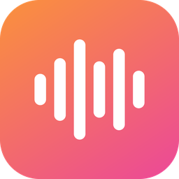
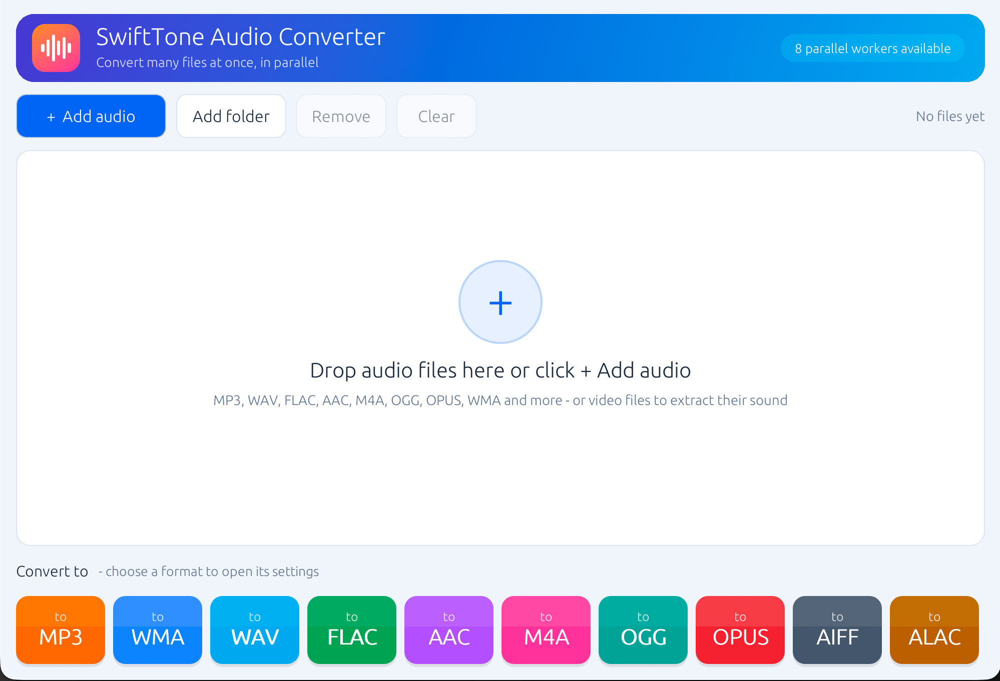

<div align="center">



# SwiftTone

**A fast, native audio converter for macOS and Windows.**
Drop in a stack of files, pick a format, and SwiftTone converts them all at once, in parallel.

[](https://github.com/EbMrBeb/SwiftTone/releases/latest)
[](https://github.com/EbMrBeb/SwiftTone/releases)


[**Download**](#download) · [Features](#features) · [Formats](#supported-formats) · [Install](#installation) · [Right-click menu](#windows-right-click-menu) · [FAQ](#faq)

<br>



</div>

---

## Why SwiftTone?

Most audio converters either make you do one file at a time or bury the useful settings under five menus. SwiftTone does the opposite. You add files (or a whole folder), click one of ten color-coded format buttons, and every file gets converted using all of your CPU cores. No account, no ads, no upload to someone else's server. Everything runs on your own machine.

It's a native app written in Rust, so it opens instantly and stays light, and it uses [FFmpeg](https://ffmpeg.org/) under the hood for the actual encoding, which means the output quality is the same as what the pros use.

## Features

- **Batch conversion in parallel.** SwiftTone spreads the work across your CPU cores and converts several files at the same time, so a big folder finishes far faster than with a one-at-a-time converter.
- **10 output formats.** MP3, WMA, WAV, FLAC, AAC, M4A, OGG, OPUS, AIFF and ALAC, each one a single click away.
- **Pull audio out of video.** Drop in MP4, MOV, MKV, AVI or WebM files and SwiftTone saves just the soundtrack.
- **Drag and drop.** Drop files or entire folders onto the window, or use **Add audio** and **Add folder**.
- **Per-format settings.** Choose a format to open its settings: bitrate (Optimal, or 320 down to 64 kbps), sample rate (original, 48 kHz, 44.1 kHz or 22.05 kHz), channels (same as source, stereo or mono) and bit depth for lossless formats.
- **Join files into one.** Merge a batch of clips into a single file.
- **Normalize volume.** Optional EBU R128 loudness normalization (FFmpeg `loudnorm`) so every track plays at a consistent level.
- **Never overwrites anything.** If `song.mp3` already exists, the new file is saved as `song (1).mp3`. Your originals are never touched.
- **Smart skipping.** Files already in the target format are skipped instead of being re-encoded for no reason.
- **Save where you want.** Output goes next to the originals by default, or pick any output folder. One click opens the folder when the batch is done.
- **Cancel anytime.** Stop a running batch whenever you want.
- **Windows right-click menu.** Convert files and whole folders straight from File Explorer, 7-Zip style. [More below.](#windows-right-click-menu)
- **Universal Mac app.** One build runs natively on both Apple Silicon and Intel Macs.

## Download

Grab the latest version from the [**Releases page**](https://github.com/EbMrBeb/SwiftTone/releases/latest).

| Platform | File | What it is |
| --- | --- | --- |
| **macOS** | [`SwiftTone-Installer-Mac.pkg`](https://github.com/EbMrBeb/SwiftTone/releases/latest/download/SwiftTone-Installer-Mac.pkg) | Installer. Puts SwiftTone in your Applications folder. |
| macOS | [`SwiftTone-Mac.dmg`](https://github.com/EbMrBeb/SwiftTone/releases/latest/download/SwiftTone-Mac.dmg) | Disk image. Drag SwiftTone into Applications. |
| macOS | [`SwiftTone-Mac.zip`](https://github.com/EbMrBeb/SwiftTone/releases/latest/download/SwiftTone-Mac.zip) | Just the `.app`, zipped. |
| **Windows** | [`SwiftTone-Setup-Windows.exe`](https://github.com/EbMrBeb/SwiftTone/releases/latest/download/SwiftTone-Setup-Windows.exe) | Installer (recommended). No admin rights needed. |
| Windows | [`SwiftTone-Windows.zip`](https://github.com/EbMrBeb/SwiftTone/releases/latest/download/SwiftTone-Windows.zip) | Portable version. Unzip and run, nothing to install. |

**Requirements:** macOS 11 Big Sur or newer (Apple Silicon or Intel), or 64-bit Windows 10 or newer. SwiftTone also needs FFmpeg, which takes about a minute to set up. See below.

## Installation

### macOS

1. Open **`SwiftTone-Installer-Mac.pkg`** and follow the steps, *or* open **`SwiftTone-Mac.dmg`** and drag SwiftTone into **Applications**.
2. The first time you launch it, macOS may say it can't verify the app because SwiftTone isn't notarized by Apple yet. To open it anyway:
   - In Applications, **right-click** (or Control-click) SwiftTone and choose **Open**, then click **Open** again.
   - If there's no Open button, go to **System Settings → Privacy & Security** and click **Open Anyway**.

   You only have to do this once.
3. Install FFmpeg (one option is enough):

   ```bash
   brew install ffmpeg
   ```

   Or download `ffmpeg` and `ffprobe` from [evermeet.cx/ffmpeg](https://evermeet.cx/ffmpeg/) and put both files next to SwiftTone in Applications, or in `/usr/local/bin`. Restart SwiftTone afterward.

### Windows

**Installer (recommended)**

1. Run **`SwiftTone-Setup-Windows.exe`**. It installs for your Windows account only, so you don't need administrator rights.
2. The wizard can add Start Menu and Desktop shortcuts, turn on the File Explorer right-click menu, and **install FFmpeg for you** using `winget`.
3. If SmartScreen shows "Windows protected your PC", click **More info → Run anyway**. The installer isn't code-signed yet.

To uninstall: **Settings → Apps → Installed apps → SwiftTone**. Removing SwiftTone doesn't remove FFmpeg.

**Portable**

Unzip **`SwiftTone-Windows.zip`** and double-click `SwiftTone.exe`. Then set up FFmpeg one of these ways:

```powershell
winget install ffmpeg
```

Or download the "release essentials" build from [gyan.dev/ffmpeg/builds](https://www.gyan.dev/ffmpeg/builds/), open its `bin` folder, and copy `ffmpeg.exe` and `ffprobe.exe` next to `SwiftTone.exe`.

> [!TIP]
> If SwiftTone can't find FFmpeg, it shows a notice at the top of the window telling you what's missing, so you'll know right away.

## Usage

1. **Add your files.** Drag them onto the window, or click **+ Add audio** / **Add folder**.
2. **Pick a format.** Click one of the buttons along the bottom (`to MP3`, `to FLAC`, and so on).
3. **Adjust settings if you want.** Bitrate, sample rate, channels, bit depth, output folder, join into one file, normalize volume. The defaults are best quality with the original sample rate and channels, so you can also just hit convert.
4. **Convert.** Progress shows per file. When it's done, click **Open output folder**.

## Supported formats

### Output

| Format | Type | Good for |
| --- | --- | --- |
| **MP3** | Lossy | Universal format, plays everywhere |
| **WMA** | Lossy | Windows Media Audio |
| **WAV** | Uncompressed | Editing, DAWs, maximum compatibility |
| **FLAC** | Lossless | Archiving, smaller than WAV with no quality loss |
| **AAC** | Lossy | Efficient encoding (raw ADTS stream) |
| **M4A** | Lossy | AAC in an MPEG-4 container, great for Apple devices |
| **OGG** | Lossy | Open Vorbis format |
| **OPUS** | Lossy | Modern codec, excellent quality at low bitrates |
| **AIFF** | Uncompressed | Uncompressed audio for Apple software |
| **ALAC** | Lossless | Apple Lossless in an M4A container |

### Input

Anything FFmpeg can read, including **MP3, WAV, FLAC, AAC, M4A, OGG, OPUS, WMA, AIFF, APE, AMR, MKA** and video files like **MP4, MOV, MKV, AVI and WebM** (audio track only).

## Windows right-click menu

SwiftTone can add a submenu to File Explorer's right-click menu for audio files and folders:

```
SwiftTone ▸  Open in SwiftTone
             Convert to ▸  MP3, WAV, FLAC, AAC, M4A, OGG, OPUS, WMA, AIFF, ALAC
             Convert all audio in this folder to ▸  (same list)
```

Right-clicking a folder, or the empty space inside one, shows **Open folder in SwiftTone** and **Convert all audio in this folder to**.

**Turn it on**, either way works:

- In SwiftTone, click **Add to right-click menu** (below the toolbar), or
- From the folder that holds `SwiftTone.exe`, run:

  ```powershell
  SwiftTone.exe --install-context-menu
  ```

**Turn it off:** click **Remove from right-click menu**, or run `SwiftTone.exe --uninstall-context-menu`.

Good to know:

- It's added for your Windows account only. It only writes registry entries under `HKEY_CURRENT_USER\Software\Classes`, with no admin rights and nothing system-wide.
- The menu points to the exact `SwiftTone.exe` you turned it on from. If you move it, click **Update right-click menu** (or run `--install-context-menu` again) from the new location.
- On **Windows 11** the entry lives in the classic menu: right-click, then **Show more options**, or hold **Shift** while right-clicking.
- Select a bunch of files and choose **Convert to** once. They all open in **one** SwiftTone window and convert together with the default settings.
- **Convert all audio in this folder** only looks at that folder (not subfolders) and skips files already in the chosen format.

## FAQ

<details>
<summary><b>Why does macOS or Windows warn me when I open it?</b></summary>

SwiftTone isn't code-signed or notarized yet, so both operating systems show a one-time "unknown developer" warning. Follow the steps in [Installation](#installation) to open it. After the first launch, it opens normally.
</details>

<details>
<summary><b>Why do I need to install FFmpeg separately?</b></summary>

FFmpeg is the industry-standard engine that does the actual decoding and encoding. Keeping it separate keeps SwiftTone's download small and lets you update FFmpeg on your own. On Windows, the installer can set it up for you automatically.
</details>

<details>
<summary><b>Does SwiftTone upload my files anywhere?</b></summary>

No. Everything is converted locally on your computer. Nothing is sent over the internet.
</details>

<details>
<summary><b>Will it overwrite my files?</b></summary>

Never. Your originals are left alone, and if a converted file would clash with one that already exists, SwiftTone adds a number to the name instead, like <code>song (1).mp3</code>.
</details>

<details>
<summary><b>Which format should I pick?</b></summary>

- Want it to play on anything? **MP3**.
- Apple devices or iTunes/Music? **M4A** (or **ALAC** if you want lossless).
- Keeping a perfect copy to archive? **FLAC**.
- Editing in a DAW or video editor? **WAV** (or **AIFF** on a Mac).
- Smallest files at good quality, like voice or podcasts? **OPUS**.
</details>

## Built with

- [Rust](https://www.rust-lang.org/) for a fast, native, single-binary app
- [egui / eframe](https://github.com/emilk/egui) for the user interface
- [FFmpeg](https://ffmpeg.org/) for decoding and encoding

## Feedback

Found a bug or have an idea? [Open an issue](https://github.com/EbMrBeb/SwiftTone/issues). Please include your OS version, the file type you were converting, and what happened.

---

<div align="center">
Made by <a href="https://github.com/EbMrBeb">Braxton Gorman</a>
</div>
